# Monte Carlo Stock Simulator (NSE)


[](https://dhirajdas18.github.io/monte-carlo-stock-sim/)

A Monte Carlo risk engine for Indian equities. It simulates price paths for single stocks, correlated portfolios and trading-strategy returns. Before trusting any model, it checks the model's forecasts against real NSE history (RELIANCE, HDFCBANK, INFY, TCS, ITC and NIFTY, 2013–2026).

**Live simulator: [dhirajdas18.github.io/monte-carlo-stock-sim](https://dhirajdas18.github.io/monte-carlo-stock-sim/)**.
Pick a stock or NIFTY, one of the five models, how much history it learns from, a horizon and a rupee
amount: the page simulates 2,000 futures and shows the fan of outcomes, VaR and CVaR, and the chance of
touching a loss level against ending below it, for all five models side by side. It runs in your browser
on daily returns since 2013, rebuilt weekly.

> Monte Carlo gives a range of outcomes under a model's assumptions. It is not a price forecast. That is why every model here is validated walk-forward before it's used.

<a href="docs/img/gbm-fan.png"><picture><source media="(prefers-reduced-motion: reduce)" srcset="docs/img/gbm-fan.png">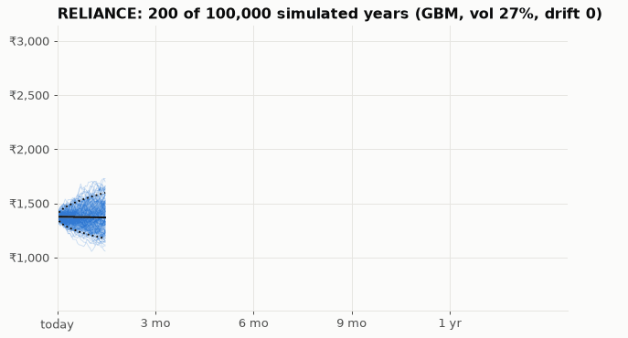</picture></a>

## Features

- [x] **Data pipeline with corporate-action checks.** Yahoo Finance or a local NSE bhavcopy lake. True traded prices are rebuilt from split ratios, and splits and bonuses are detected automatically.
- [x] **Return and volatility analytics.** Simple vs log returns, annualised volatility, a test of √time scaling on real data, and fat-tail diagnostics.
- [x] **GBM path simulation.** Vectorised and seeded, validated against closed-form results, with antithetic variance reduction and a drift-uncertainty analysis.
- [x] **Risk measures.** VaR and CVaR (simulated vs historical), percentile bands, and the probability of touching a price vs ending beyond it.
- [x] **Walk-forward coverage testing.** Each forecast uses only past data (tested for look-ahead), and is checked at both the 90% and 99% levels.
- [x] **Alternative models.** Student-t, Merton jump-diffusion, historical bootstrap and block bootstrap, all compared on the same walk-forward test.
- [x] **Correlated portfolio simulation.** Cholesky and joint-day block bootstrap, buy-and-hold portfolios, and calm vs crash-day correlation.
- [x] **In-browser simulator.** The five models' step rules in JavaScript (settings fitted in Python), tested against the Python through Node; one static page on GitHub Pages.
- [x] **Strategy risk.** Resampled equity curves, drawdown distributions, the probability that an edge is luck, and Kelly position sizing.

## Findings

### 1. Unadjusted prices invent crashes

The 5 stocks show 9 one-day drops of 31–51% in raw prices. Every one is a split or bonus issue, not a loss. In a check against a local NSE data lake that missed ITC's 2016 bonus, ITC showed 0.9%/yr against a real 6.9%/yr (that lake isn't public, so this figure can't be reproduced from Yahoo). The fetch script now flags any *adjusted* one-day drop over 20% for review; on the Yahoo data the only hit is INFY's real −21% results-day fall in April 2013.

<table><tr>
<td><a href="docs/img/data-raw-vs-adjusted.png"><picture><source media="(prefers-reduced-motion: reduce)" srcset="docs/img/data-raw-vs-adjusted.png">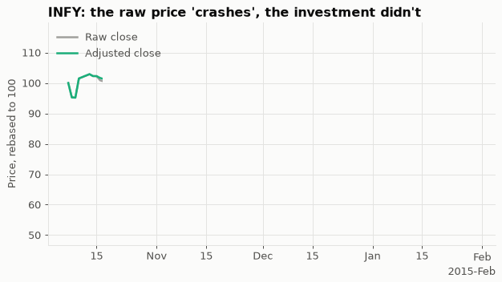</picture></a></td>
<td><a href="docs/img/data-growth-of-1-lakh.png"><picture><source media="(prefers-reduced-motion: reduce)" srcset="docs/img/data-growth-of-1-lakh.png">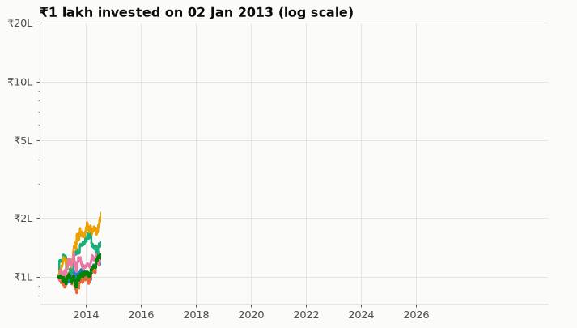</picture></a></td>
</tr></table>

### 2. Real returns have fat tails, and √time only holds short-term

Under a normal distribution, a day beyond 4σ should happen about 0.2 times in 14 years. Each stock had 16–22. Scaling daily volatility by √days matches realised volatility to within ~5% up to 1 month, but overstates it at 3–12 months, by up to ~40% for RELIANCE at 1 year (27% vs 19%). The long-horizon figures rest on only ~13 independent years.

<table><tr>
<td><a href="docs/img/returns-vs-normal.png"><picture><source media="(prefers-reduced-motion: reduce)" srcset="docs/img/returns-vs-normal.png"></picture></a></td>
<td><a href="docs/img/returns-sqrt-time.png"><picture><source media="(prefers-reduced-motion: reduce)" srcset="docs/img/returns-sqrt-time.png">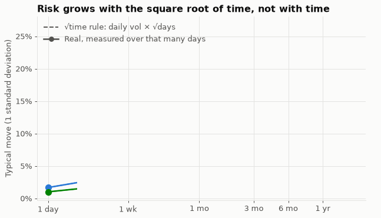</picture></a></td>
</tr></table>

### 3. The historical mean return is not a forecast

RELIANCE's 13.6-year drift is 18.7%/yr ± 7.3% (1 standard error). Within ±2 standard errors, the median 1-year price ranges from ₹1,385 to ₹1,851 (₹1,327 at zero drift), so risk simulations default to zero drift. Even at zero drift, 55% of paths end below today's price (volatility drag). Antithetic sampling cuts the error of the simulated mean 3–5× at the same path count.

<a href="docs/img/gbm-drift-uncertainty.png"><picture><source media="(prefers-reduced-motion: reduce)" srcset="docs/img/gbm-drift-uncertainty.png"></picture></a>

<table><tr>
<td><a href="docs/img/gbm-mean-vs-median.png"><picture><source media="(prefers-reduced-motion: reduce)" srcset="docs/img/gbm-mean-vs-median.png"></picture></a></td>
<td><a href="docs/img/gbm-paths-needed.png"><picture><source media="(prefers-reduced-motion: reduce)" srcset="docs/img/gbm-paths-needed.png">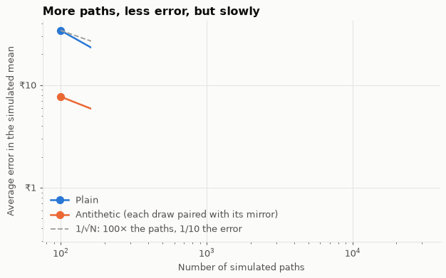</picture></a></td>
</tr></table>

### 4. Real bad months look milder than the model until the worst 1%

On ₹1 lakh of RELIANCE over 1 month, real history looks *safer* than the GBM model at the 95% level, for VaR (₹10.4k vs ₹12.1k) and CVaR (₹14.3k vs ₹14.9k) alike. Only deep in the tail does it flip: the average loss in the worst 1% of real months is ₹22.8k, 22% worse than the model's ₹18.8k. Risk checks need to look at the 99% tail, not just 95%. Stop-losses trigger on touches: a −10% level is touched within 3 months 41% of the time but is still breached at the end only 24% of the time.

<table><tr>
<td><a href="docs/img/risk-var-cvar.png"><picture><source media="(prefers-reduced-motion: reduce)" srcset="docs/img/risk-var-cvar.png">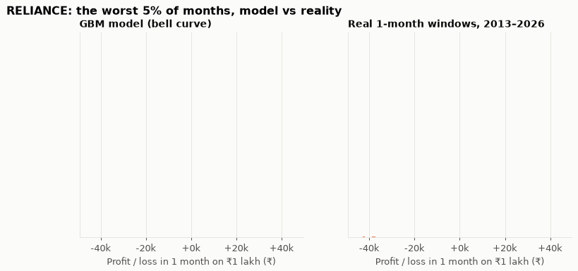</picture></a></td>
<td><a href="docs/img/risk-touch-vs-end.png"><picture><source media="(prefers-reduced-motion: reduce)" srcset="docs/img/risk-touch-vs-end.png"></picture></a></td>
</tr></table>

### 5. A model can pass at 90% and fail at 99%

This is a walk-forward test over 2016–2026: 2,636 one-month forecasts per stock, each made using only the 3 years before it. GBM's 90% band holds (90–93% coverage). Its 99% band is breached 2–3× too often, and up to 3.5× on the downside. Its sense of risk also lags: coverage fell to ~70% in 2020 and sat near 100% in 2021–23. Using only prior data, it rated NIFTY's Feb–Mar 2020 month (−37%) at 1 in 10³⁹. Caveat: the 2,636 forecasts overlap day by day, so there are only ~125 independent months, and most of the excess 99% misses come from one episode (2020). Treat the 2–3× as indicative, not precise.

<table><tr>
<td><a href="docs/img/validate-coverage.png"><picture><source media="(prefers-reduced-motion: reduce)" srcset="docs/img/validate-coverage.png"></picture></a></td>
<td><a href="docs/img/validate-worst-months.png"><picture><source media="(prefers-reduced-motion: reduce)" srcset="docs/img/validate-worst-months.png">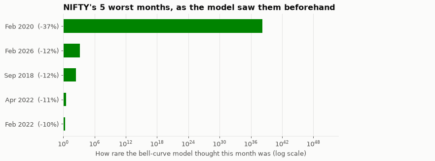</picture></a></td>
</tr></table>

### 6. No model, trained on calmer years, foresaw 2020–2026

Five models (GBM, Student-t, Merton jump-diffusion, bootstrap, block bootstrap) were trained on 2013–2019 only and asked how deep a really bad month gets (average loss in the worst 1% of months). Against what 2020–2026 actually delivered, every model fell short: by 34–41% for RELIANCE and 59–63% for NIFTY. The block bootstrap was no better than the rest.

Fitted on the full history, the block bootstrap does match the real figure (₹23.0k vs ₹23.0k for RELIANCE), but that is replay, not prediction: its 20-day blocks nearly reproduce the same windows it's scored on. A model can't contain a crash that isn't in its training data, so a margin of safety (stress scenarios) has to be added by hand. On the walk-forward 99% test, no model beat GBM in a meaningful way: with ~10 misses per model, a gap of one or two misses is noise.

<table><tr>
<td><a href="docs/img/models-tail.png"><picture><source media="(prefers-reduced-motion: reduce)" srcset="docs/img/models-tail.png"></picture></a></td>
<td><a href="docs/img/models-coverage.png"><picture><source media="(prefers-reduced-motion: reduce)" srcset="docs/img/models-coverage.png">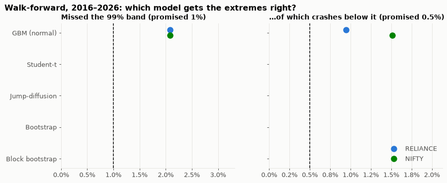</picture></a></td>
</tr></table>

### 7. Diversification is real, but simple models overstate it

On ₹5 lakh, holding one stock (RELIANCE) loses ₹1.14L (22.9%) on average in the worst 1% of months. An equal-weight basket of the 5 cuts that to ₹88k (17.6%) when real days are replayed with all 5 stocks together. Treating the stocks as independent claims ₹42k (8.4%), and a correlation matrix with bell-curve moves claims ₹60k (12.0%): they make the basket look about 2× and 1.5× safer than history says. The reason is crash days. Every one of the 10 stock pairs moves together more on NIFTY's worst 10% of days (average correlation 0.18 → 0.25), so protection thins out exactly when it's needed.

<a href="docs/img/portfolio-basket-risk.png"><picture><source media="(prefers-reduced-motion: reduce)" srcset="docs/img/portfolio-basket-risk.png">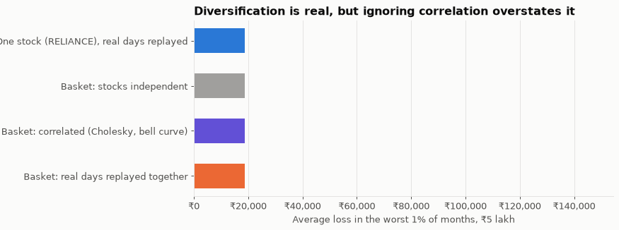</picture></a>

<table><tr>
<td><a href="docs/img/portfolio-correlation.png"><picture><source media="(prefers-reduced-motion: reduce)" srcset="docs/img/portfolio-correlation.png">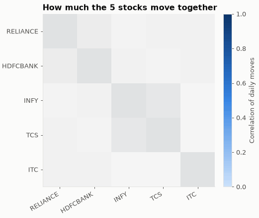</picture></a></td>
<td><a href="docs/img/portfolio-crash-correlation.png"><picture><source media="(prefers-reduced-motion: reduce)" srcset="docs/img/portfolio-crash-correlation.png">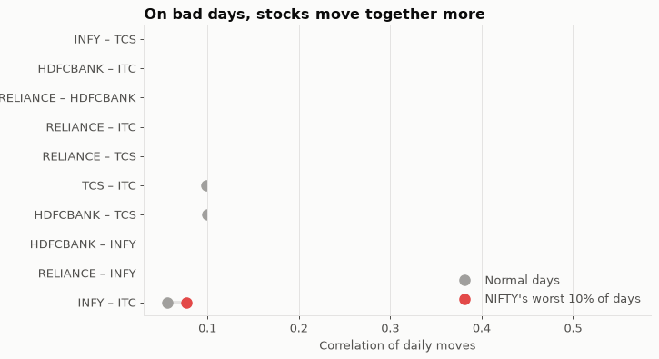</picture></a></td>
</tr></table>

### 8. A backtest is one possible history

Comparing NIFTY buy-and-hold with a simple momentum rule (hold the top 2 of the 5 stocks by 12-month return, monthly rebalance, no costs) over 2014–2026:

- **The edge may be luck.** Momentum beat NIFTY by 1.65%/yr, but in 33% of block-bootstrap resamples its edge is zero or negative. That's before trading costs, and the NIFTY series here excludes dividends while the stocks include them.
- **Plan for a worse drawdown than the backtest showed.** Both had a 38% worst fall. Reshuffled in 20-day runs, the median is 35–37% and 1 in 20 histories falls 54–58%. Reshuffling single days understates it (median 29–34%) because it breaks up bad streaks.
- **Bet size matters more than the edge.** Full Kelly exposure is 3.9× capital: a 46% chance of halving the money at some point within 10 years. Half Kelly cuts that to 14%, and 100% invested without leverage (≈ ¼ Kelly) to about 1%. Past full Kelly, even the median outcome shrinks, and at 2× Kelly ₹1 typically ends near ₹0.7.

<a href="docs/img/strategy-alternate-histories.png"><picture><source media="(prefers-reduced-motion: reduce)" srcset="docs/img/strategy-alternate-histories.png">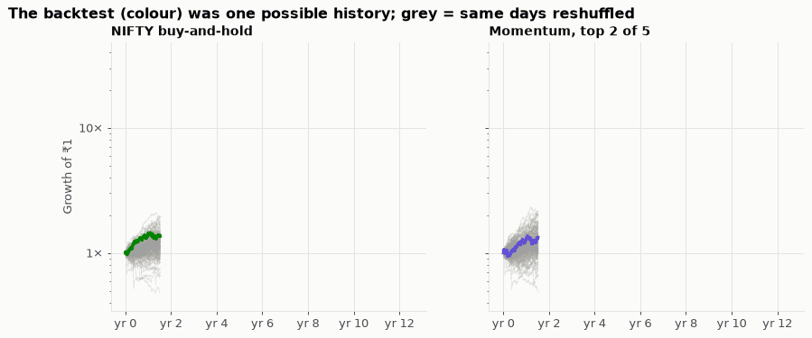</picture></a>

<table><tr>
<td><a href="docs/img/strategy-drawdown.png"><picture><source media="(prefers-reduced-motion: reduce)" srcset="docs/img/strategy-drawdown.png">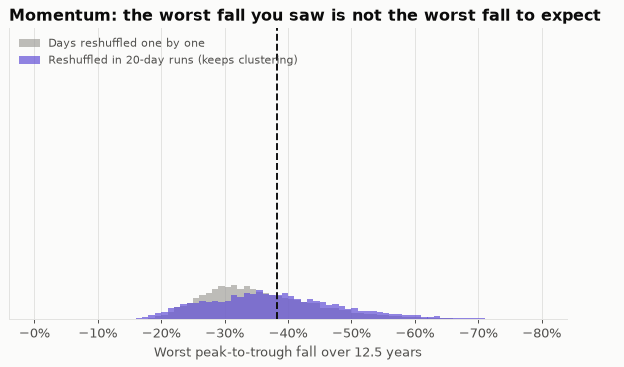</picture></a></td>
<td><a href="docs/img/strategy-luck.png"><picture><source media="(prefers-reduced-motion: reduce)" srcset="docs/img/strategy-luck.png">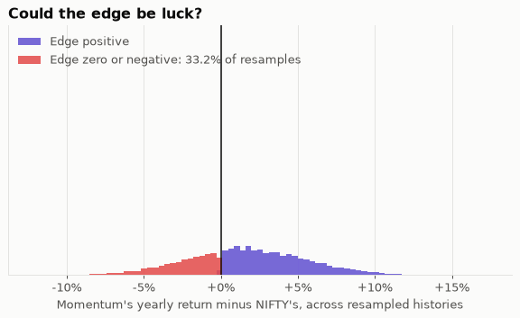</picture></a></td>
</tr></table>

<a href="docs/img/strategy-kelly.png"><picture><source media="(prefers-reduced-motion: reduce)" srcset="docs/img/strategy-kelly.png">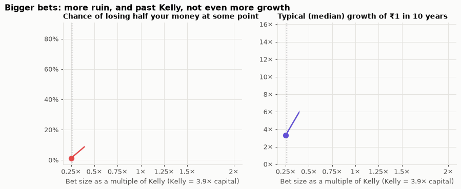</picture></a>

## Use it on your own strategy

```python
import pandas as pd
from mc.strategy import luck_probability, max_drawdown, ruin_probability, simulate_equity

r = pd.read_csv("my_strategy_daily_returns.csv", index_col=0, parse_dates=True)["ret"]
bench = pd.read_csv("benchmark_daily_returns.csv", index_col=0, parse_dates=True)["ret"]

paths = simulate_equity(r, days=len(r), n_paths=10_000, block=20, seed=0)
print("median / 95th pct max drawdown:", pd.Series(max_drawdown(paths)).quantile([0.5, 0.95]))
print("chance the edge is luck:", luck_probability(r, bench, block=20, seed=0))
print("chance of halving at full exposure:", ruin_probability(r, 1.0, 2520, 5000, block=20, seed=0))
```

## Quick start

```bash
uv sync
uv run python scripts/fetch_data.py   # prices from Yahoo Finance into data/
uv run mc-report data                 # charts into out/, key numbers to stdout
uv run mc-report returns
uv run mc-report gbm
uv run mc-report risk
uv run mc-report validate
uv run mc-report models
uv run mc-report portfolio
uv run mc-report strategy
uv run python scripts/build_site.py   # the simulator page into site/
uv run pytest
```

All randomness is seeded, so every reported number can be reproduced.

## Design

- `src/mc/`: one module per concern: `data`, `returns`, `gbm`, `risk`, `validate`, `models`, `portfolio`, `strategy`, `plots`, `reports`, `site`.
- `src/mc/sim.js`, `simulator.html`, `page.html`: the dashboard. Python fits each model's settings per stock and history window (`site.model_params`, the same formulas as `models`); the browser simulates with the same step rules, and a test runs the JavaScript through Node against the Python. Daily log returns are embedded as integers (0.001% units).
- Every model shares one interface, `model(past_log_returns, s0, days, n_paths, rng) -> paths`, so any model can go through the same walk-forward test.
- `mc-report <topic>` regenerates a topic's charts and numbers from raw data, so nothing in this README is typed by hand.
- Tests use synthetic data with known answers and never depend on downloaded files. CI runs `ruff` and `pytest` on every push; a second workflow fetches prices, rebuilds the page and publishes it to GitHub Pages weekly.
- No market data is committed. Set `MC_LAKE_DIR` to read a local NSE bhavcopy lake (`panel.parquet` and `market.parquet`) instead of Yahoo.

Stack: Python 3.12 · uv · NumPy · pandas · SciPy · Matplotlib · Plotly.js · pytest · GitHub Actions.

MIT licence.
