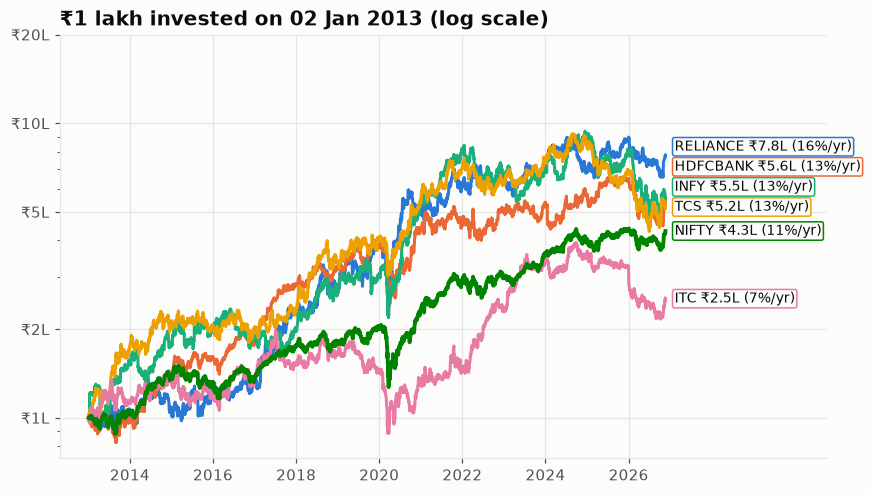

# Monte Carlo Stock Simulator (NSE)


A Monte Carlo risk engine for Indian equities. It simulates price paths for single stocks, correlated portfolios and trading-strategy returns. Before trusting any model, it checks the model's forecasts against real NSE history.

> Monte Carlo gives a range of outcomes under a model's assumptions. It is not a price forecast. That is why this project validates every model walk-forward before using it.



## Features

- [x] **Data pipeline with corporate-action checks.**
  - Daily prices for RELIANCE, HDFCBANK, INFY, TCS, ITC and NIFTY, 2013–2026, from Yahoo Finance or a local NSE bhavcopy lake.
  - True traded prices are rebuilt from split ratios.
  - Splits and bonuses are detected automatically, so they can't show up as fake crashes.
- [ ] Return and volatility analytics, including fat-tail diagnostics
- [ ] GBM path simulation with antithetic variance reduction, plus a drift-uncertainty analysis
- [ ] Risk measures: VaR, CVaR, and the probability of touching a price vs ending beyond it
- [ ] Walk-forward coverage testing of each model's forecast bands
- [ ] Alternative models: Student-t, Merton jump-diffusion, historical bootstrap and block bootstrap
- [ ] Correlated portfolio simulation (Cholesky and joint-day bootstrap), with a check on how correlation changes in crashes
- [ ] Strategy risk: drawdown distributions, the probability that an edge is luck, and Kelly position sizing

## Findings so far

| Finding | Evidence |
|---|---|
| Unadjusted prices invent crashes | 9 one-day drops of 31–51% across the 5 stocks are splits and bonuses, not losses ([chart](docs/img/data-raw-vs-adjusted.png)) |
| One missed corporate action corrupts a whole history | A data source that missed ITC's 2016 1:2 bonus reports 0.9%/yr. The real figure is 6.9%/yr. The pipeline flags any adjusted one-day drop over 20% |
| Same market, very different outcomes | ₹1 lakh invested in Jan 2013 became anywhere from ₹2.5L (ITC) to ₹7.8L (RELIANCE). NIFTY, excluding dividends, ended at ₹4.3L |

## Quick start

```bash
uv sync
uv run python scripts/fetch_data.py   # prices from Yahoo Finance into data/
uv run mc-report data                 # charts into out/, key numbers to stdout
uv run pytest
```

All randomness is seeded, so every reported number can be reproduced.

## Design

- `src/mc/`: one module per concern (`data`, `plots`, `reports`, plus the simulation modules as they land).
- `mc-report <topic>` regenerates a topic's charts and numbers from raw data, so nothing in this README is typed by hand.
- Tests use synthetic data with known answers. They never depend on downloaded files. CI runs `ruff` and `pytest` on every push.
- No market data is committed. Set `MC_LAKE_DIR` to read a local NSE bhavcopy lake (`panel.parquet` and `market.parquet`) instead of Yahoo.

Stack: Python 3.12 · uv · NumPy · pandas · SciPy · Matplotlib · pytest · GitHub Actions.

MIT licence.
