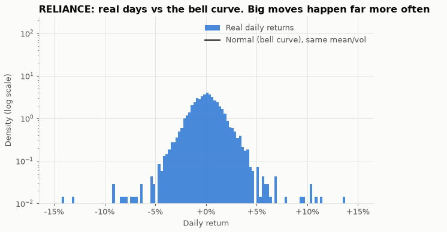
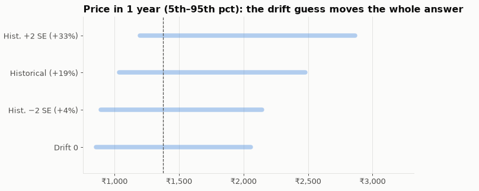
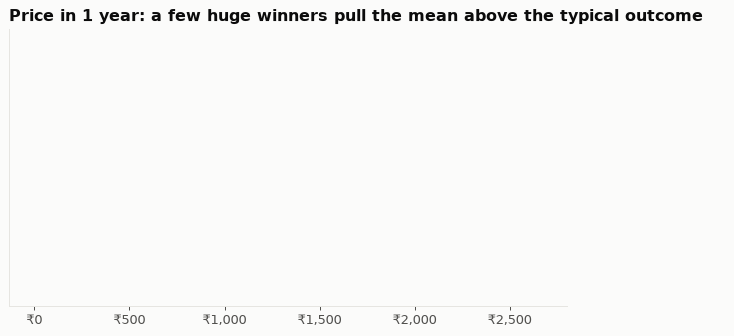
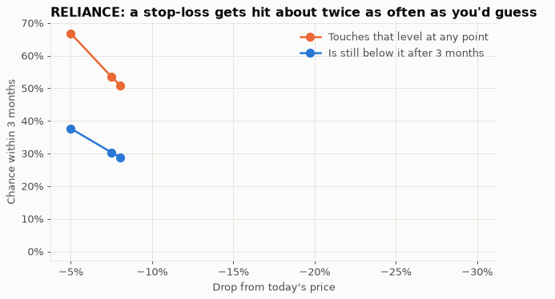
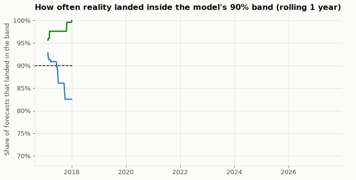
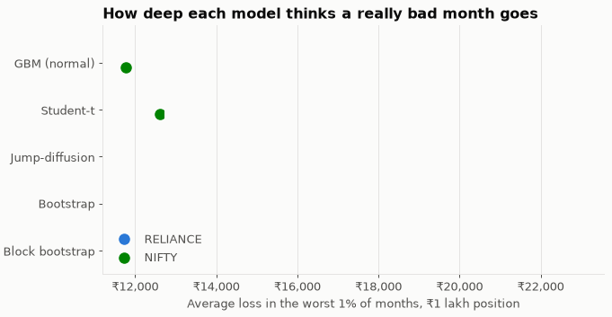

# Monte Carlo Stock Simulator (NSE)


A Monte Carlo risk engine for Indian equities. It simulates price paths for single stocks, correlated portfolios and trading-strategy returns. Before trusting any model, it checks the model's forecasts against real NSE history (RELIANCE, HDFCBANK, INFY, TCS, ITC and NIFTY, 2013–2026).

> Monte Carlo gives a range of outcomes under a model's assumptions. It is not a price forecast. That is why every model here is validated walk-forward before it's used.

<a href="docs/img/gbm-fan.png"><picture><source media="(prefers-reduced-motion: reduce)" srcset="docs/img/gbm-fan.png"></picture></a>

## Features

- [x] **Data pipeline with corporate-action checks.** Yahoo Finance or a local NSE bhavcopy lake. True traded prices are rebuilt from split ratios, and splits and bonuses are detected automatically.
- [x] **Return and volatility analytics.** Simple vs log returns, annualised volatility, a test of √time scaling on real data, and fat-tail diagnostics.
- [x] **GBM path simulation.** Vectorised and seeded, validated against closed-form results, with antithetic variance reduction and a drift-uncertainty analysis.
- [x] **Risk measures.** VaR and CVaR (simulated vs historical), percentile bands, and the probability of touching a price vs ending beyond it.
- [x] **Walk-forward coverage testing.** Each forecast uses only past data (tested for look-ahead), and is checked at both the 90% and 99% levels.
- [x] **Alternative models.** Student-t, Merton jump-diffusion, historical bootstrap and block bootstrap, all compared on the same walk-forward test.
- [x] **Correlated portfolio simulation.** Cholesky and joint-day block bootstrap, buy-and-hold portfolios, and calm vs crash-day correlation.
- [ ] Strategy risk: drawdown distributions, the probability that an edge is luck, and Kelly position sizing

## Findings

### 1. Unadjusted prices invent crashes

The 5 stocks show 9 one-day drops of 31–51% in raw prices. Every one is a split or bonus issue, not a loss. A data source that missed one ITC bonus reports 0.9%/yr; the real figure is 6.9%/yr. The pipeline flags any adjusted one-day drop over 20%.

<table><tr>
<td><a href="docs/img/data-raw-vs-adjusted.png"><picture><source media="(prefers-reduced-motion: reduce)" srcset="docs/img/data-raw-vs-adjusted.png"></picture></a></td>
<td><a href="docs/img/data-growth-of-1-lakh.png"><picture><source media="(prefers-reduced-motion: reduce)" srcset="docs/img/data-growth-of-1-lakh.png"></picture></a></td>
</tr></table>

### 2. Real returns have fat tails, and √time only holds short-term

Under a normal distribution, a day beyond 4σ should happen about 0.2 times in 14 years. Each stock had 16–22. Scaling daily volatility by √days matches realised volatility to within ~5% up to 1 month, but overstates it by 5–30% at 3–12 months.

<table><tr>
<td><a href="docs/img/returns-vs-normal.png"><picture><source media="(prefers-reduced-motion: reduce)" srcset="docs/img/returns-vs-normal.png"></picture></a></td>
<td><a href="docs/img/returns-sqrt-time.png"><picture><source media="(prefers-reduced-motion: reduce)" srcset="docs/img/returns-sqrt-time.png"></picture></a></td>
</tr></table>

### 3. The historical mean return is not a forecast

RELIANCE's 13.6-year drift is 18.7%/yr ± 7.3% (1 standard error). Plausible drifts move the median 1-year price from ₹1,327 to ₹1,851, so risk simulations default to zero drift. Even at zero drift, 55% of paths end below today's price (volatility drag). Antithetic sampling cuts the error of the simulated mean 3–5× at the same path count.

<a href="docs/img/gbm-drift-uncertainty.png"><picture><source media="(prefers-reduced-motion: reduce)" srcset="docs/img/gbm-drift-uncertainty.png"></picture></a>

<table><tr>
<td><a href="docs/img/gbm-mean-vs-median.png"><picture><source media="(prefers-reduced-motion: reduce)" srcset="docs/img/gbm-mean-vs-median.png"></picture></a></td>
<td><a href="docs/img/gbm-paths-needed.png"><picture><source media="(prefers-reduced-motion: reduce)" srcset="docs/img/gbm-paths-needed.png"></picture></a></td>
</tr></table>

### 4. VaR hides the tail; CVaR doesn't

On ₹1 lakh of RELIANCE over 1 month, historical VaR 95% (₹10.1k) looks safer than the GBM model's (₹12.1k). Yet the historical average loss in the worst 1% of months is ₹22.6k, against the model's ₹18.8k. Stop-losses trigger on touches: a −10% level is touched within 3 months 41% of the time but is still breached at the end only 24% of the time.

<table><tr>
<td><a href="docs/img/risk-var-cvar.png"><picture><source media="(prefers-reduced-motion: reduce)" srcset="docs/img/risk-var-cvar.png"></picture></a></td>
<td><a href="docs/img/risk-touch-vs-end.png"><picture><source media="(prefers-reduced-motion: reduce)" srcset="docs/img/risk-touch-vs-end.png"></picture></a></td>
</tr></table>

### 5. A model can pass at 90% and fail at 99%

This is a walk-forward test over 2016–2026: 2,636 one-month forecasts per stock, each made using only the 3 years before it. GBM's 90% band holds (90–93% coverage). Its 99% band is breached 2–3× too often, and up to 3.5× on the downside. Its sense of risk also lags: coverage fell to ~70% in 2020 and sat near 100% in 2021–23. Using only prior data, it rated NIFTY's Feb–Mar 2020 month (−37%) at 1 in 10³⁹.

<table><tr>
<td><a href="docs/img/validate-coverage.png"><picture><source media="(prefers-reduced-motion: reduce)" srcset="docs/img/validate-coverage.png"></picture></a></td>
<td><a href="docs/img/validate-worst-months.png"><picture><source media="(prefers-reduced-motion: reduce)" srcset="docs/img/validate-worst-months.png"></picture></a></td>
</tr></table>

### 6. Only the block bootstrap gets the depth of a bad month right

Five models were compared on the same data. For the average loss in the worst 1% of months, the block bootstrap gives ₹23.0k (RELIANCE) and ₹20.5k (NIFTY), against real values of ₹22.8k and ₹20.75k. Every other model understates it, GBM on NIFTY by 43%.

Resampling single days (plain bootstrap) barely beats GBM. Over a month, independent fat-tailed days average out. It's bad days *clustering together* that makes monthly tails fat.

No model fixes the walk-forward 99% misses. Those come from volatility regime shifts, not the shape of the distribution.

<table><tr>
<td><a href="docs/img/models-tail.png"><picture><source media="(prefers-reduced-motion: reduce)" srcset="docs/img/models-tail.png"></picture></a></td>
<td><a href="docs/img/models-coverage.png"><picture><source media="(prefers-reduced-motion: reduce)" srcset="docs/img/models-coverage.png"></picture></a></td>
</tr></table>

### 7. Diversification is real, but simple models overstate it

On ₹5 lakh, holding one stock (RELIANCE) loses ₹1.14L (22.9%) on average in the worst 1% of months. An equal-weight basket of the 5 cuts that to ₹88k (17.6%) when real days are replayed with all 5 stocks together. Treating the stocks as independent claims ₹42k (8.4%), and a correlation matrix with bell-curve moves claims ₹60k (12.0%): both make the basket look 2–3× safer than history says. The reason is crash days. Every one of the 10 stock pairs moves together more on NIFTY's worst 10% of days (average correlation 0.18 → 0.25), so protection thins out exactly when it's needed.

<a href="docs/img/portfolio-basket-risk.png"><picture><source media="(prefers-reduced-motion: reduce)" srcset="docs/img/portfolio-basket-risk.png"></picture></a>

<table><tr>
<td><a href="docs/img/portfolio-correlation.png"><picture><source media="(prefers-reduced-motion: reduce)" srcset="docs/img/portfolio-correlation.png"></picture></a></td>
<td><a href="docs/img/portfolio-crash-correlation.png"><picture><source media="(prefers-reduced-motion: reduce)" srcset="docs/img/portfolio-crash-correlation.png"></picture></a></td>
</tr></table>

## Quick start

```bash
uv sync
uv run python scripts/fetch_data.py   # prices from Yahoo Finance into data/
uv run mc-report data                 # charts into out/, key numbers to stdout
uv run mc-report returns
uv run mc-report gbm
uv run mc-report risk
uv run mc-report validate
uv run mc-report models
uv run mc-report portfolio
uv run pytest
```

All randomness is seeded, so every reported number can be reproduced.

## Design

- `src/mc/`: one module per concern: `data`, `returns`, `gbm`, `risk`, `validate`, `models`, `portfolio`, `plots`, `reports`.
- Every model shares one interface, `model(past_log_returns, s0, days, n_paths, rng) -> paths`, so any model can go through the same walk-forward test.
- `mc-report <topic>` regenerates a topic's charts and numbers from raw data, so nothing in this README is typed by hand.
- Tests use synthetic data with known answers and never depend on downloaded files. CI runs `ruff` and `pytest` on every push.
- No market data is committed. Set `MC_LAKE_DIR` to read a local NSE bhavcopy lake (`panel.parquet` and `market.parquet`) instead of Yahoo.

Stack: Python 3.12 · uv · NumPy · pandas · SciPy · Matplotlib · pytest · GitHub Actions.

MIT licence.
